# UTS – Aplikasi Web Pemesanan Buku pada Toko Online

## Identitas Praktikum

- **Nama:** Mu’ammar Kadafi
- **NIM:** 312510192
- **Program Studi/Semester:** Teknik Informatika / 3
- **Mata Kuliah:** Pemrograman Web
- **Dosen Pengampu:** Agung Nugroho, S.Kom., M.Kom.
- **Kelas:** I253C
- **Hari/Tanggal:** Sabtu, 7 November 2026
- **Pertemuan:** 8 (Offline)

# BUKU.KU – Bookstore Management System

BUKU.KU merupakan aplikasi web sederhana untuk pemesanan dan pengelolaan buku pada sebuah toko online. Aplikasi ini dikembangkan menggunakan HTML, CSS, dan JavaScript dengan tampilan yang responsif serta navigasi antarmenu yang dinamis tanpa perlu memuat ulang seluruh halaman.

## Fitur

1. **Login:** masuk ke aplikasi menggunakan email dan kata sandi.
2. **Lupa Password:** mengubah kata sandi akun melalui formulir pemulihan.
3. **Daftar:** membuat akun pengguna baru.
4. **Dashboard:** menampilkan sapaan pengguna, jumlah katalog buku, total stok, jumlah pengguna, dan status sistem.
5. **Informasi Stok/Katalog:**
   - Menampilkan daftar katalog buku.
   - Menambahkan data buku baru.
   - Mencari buku berdasarkan kode atau judul buku.
6. **Pemesanan:**
   - Menampilkan daftar pemesanan.
   - Menambahkan pemesanan baru.
   - Mengubah data pemesanan.
   - Mencari pesanan berdasarkan nomor pesanan atau nama pemesan.
   - Menghitung total pembayaran berdasarkan buku dan jumlah pesanan.
7. **Tracking Pengiriman:**
   - Menampilkan informasi status pengiriman.
   - Mencari pengiriman berdasarkan nomor Delivery Order (DO).
   - Menampilkan informasi pemesan, ekspedisi, tanggal pengiriman, dan riwayat perjalanan paket.
8. **Laporan Pemesanan:** menyediakan menu laporan pemesanan.
9. **History Transaksi:** menyediakan menu riwayat transaksi pemesanan.
10. **Profil Saya:** menampilkan informasi akun pengguna yang sedang login.
11. **Logout:** mengakhiri sesi login dan keluar dari aplikasi.
12. **Dark/Light Mode:** mengubah tampilan aplikasi antara tema terang dan gelap.

## Keunggulan Aplikasi

- **Responsif:** tampilan aplikasi menyesuaikan ukuran layar perangkat, baik desktop, tablet, maupun ponsel.
- **Navigasi Dinamis:** perpindahan antarmenu dilakukan tanpa memuat ulang seluruh halaman (*no page reload*) dengan memanfaatkan JavaScript dan Fetch API.
- **Antarmuka Interaktif:** menggunakan Bootstrap Icons dan SweetAlert2 untuk mendukung tampilan serta interaksi pengguna.
- **Penyimpanan Lokal:** menggunakan `localStorage` dan `sessionStorage` untuk menyimpan data pada browser.
- **Tema Tampilan:** menyediakan pilihan Dark Mode dan Light Mode.

## Teknologi

- HTML5
- CSS3
- JavaScript
- Bootstrap 5.3.3
- Bootstrap Icons 1.11.3
- SweetAlert2
- Fetch API
- Browser `localStorage` dan `sessionStorage`

## Struktur Folder

```text
tugas-uts-web1/
├── css/
│   └── style.css
├── img/
│   ├── kepemimpinan.jpg
│   ├── manajemen_keuangan.jpg
│   ├── mikrobiologi.jpg
│   ├── paud_perkembangan.jpg
│   └── pengantar_komunikasi.jpg
├── js/
│   ├── checkout.js
│   ├── dashboard.js
│   ├── data.js
│   ├── script.js
│   ├── stok.js
│   └── tracking.js
├── checkout.html
├── dashboard.html
├── index.html
├── README.md
├── stok.html
├── tracking.html
└── transaksi.html
```

## Persyaratan Sistem

- Web browser modern, seperti Google Chrome, Microsoft Edge, atau Mozilla Firefox.
- Web server lokal, seperti XAMPP dengan Apache.
- Koneksi internet untuk memuat library Bootstrap, Bootstrap Icons, dan SweetAlert2 melalui CDN.

## Cara Menjalankan Aplikasi

1. Salin folder `tugas-uts-web1` ke dalam direktori `htdocs` pada instalasi XAMPP.
2. Buka XAMPP Control Panel.
3. Jalankan layanan **Apache**.
4. Buka browser.
5. Akses alamat berikut:

   ```text
   http://localhost/tugas-uts-web1/
   ```

   Sesuaikan alamat tersebut apabila folder proyek berada di dalam subdirektori `htdocs`.

6. Setelah halaman login terbuka, masukkan email dan kata sandi salah satu akun contoh berikut.

> **Penting:** Aplikasi harus dijalankan melalui `localhost` atau web server lokal, bukan dengan membuka file HTML secara langsung menggunakan `file://`. Hal ini karena aplikasi memanfaatkan Fetch API (`fetch()`) untuk memuat konten halaman secara dinamis.

## Akun Pengguna Contoh

Berikut beberapa akun yang tersedia pada data awal aplikasi di `js/data.js`.

| Role | Email | Password |
|---|---|---|
| User | `rina@gmail.com` | `rina123` |
| User | `agus@gmail.com` | `agus123` |
| User | `kadafi051207@gmail.com` | `123456789` |
| Admin | `siti@gmail.com` | `siti123` |

## Contoh Nomor Tracking

Gunakan salah satu nomor DO berikut pada menu **Tracking Pengiriman** untuk mencoba fitur pencarian pengiriman.

| Nomor DO | Nama Pemesan | Ekspedisi |
|---|---|---|
| `20230012` | Rina Wulandari | JNE |
| `20230013` | Agus Pranoto | Pos Indonesia |

Data tracking tersebut merupakan data simulasi untuk keperluan demonstrasi.

## Penyimpanan Data

Aplikasi ini dikembangkan dengan fokus pada proses front-end dan belum menggunakan backend maupun database server. Data disimpan menggunakan penyimpanan lokal pada browser.

- **`localStorage`:** menyimpan data pengguna yang didaftarkan atau diperbarui, data katalog tambahan, dan data pemesanan.
- **`sessionStorage`:** menyimpan status login dan informasi pengguna selama sesi browser berlangsung.
- **`js/data.js`:** menyediakan data awal pengguna, katalog buku, dan informasi tracking.

Data yang tersimpan pada `localStorage` hanya tersedia di browser dan perangkat tempat data tersebut dibuat. Menghapus data situs atau penyimpanan browser dapat menyebabkan perubahan data yang tersimpan ikut terhapus.

### Mengembalikan Katalog ke Data Awal

Untuk menghapus data katalog tambahan dan mengembalikan katalog ke data awal dari `js/data.js`, ikuti langkah berikut:

1. Buka aplikasi melalui browser.
2. Tekan `F12` untuk membuka Developer Tools.
3. Pilih tab **Console**.
4. Masukkan perintah berikut:

   ```javascript
   localStorage.removeItem("dataKatalogBukuBookstore");
   ```

5. Tekan `Enter`.
6. Muat ulang halaman aplikasi.

## Catatan Pengembangan

- Pastikan nama file dan lokasi gambar pada `js/data.js` sesuai dengan file yang tersedia di dalam folder `img/`.
- Halaman `stok.html`, `checkout.html`, dan `tracking.html` dimuat ke dalam area konten dashboard menggunakan Fetch API.
- Perpindahan antarmenu dilakukan secara dinamis tanpa memuat ulang seluruh halaman.
- File JavaScript untuk setiap halaman harus dimuat sebelum `js/dashboard.js` pada `dashboard.html`.
- Data aplikasi bersifat lokal dan belum terhubung dengan database maupun server backend.
- Fitur Laporan Pemesanan dan History Transaksi dapat dikembangkan lebih lanjut sesuai kebutuhan.

## Tampilan Aplikasi

### 1. Login

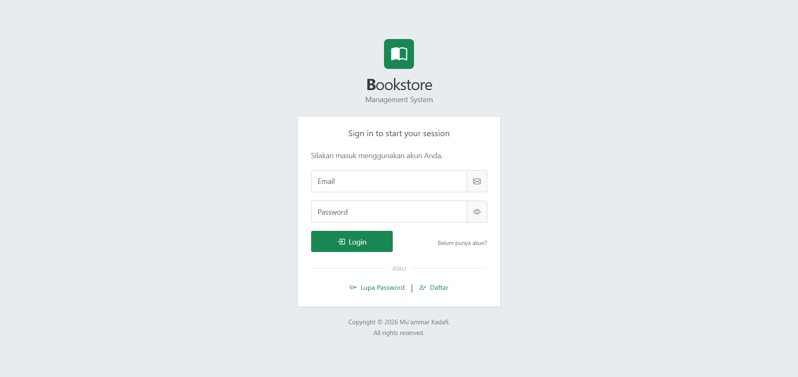

### 2. Validasi Formulir

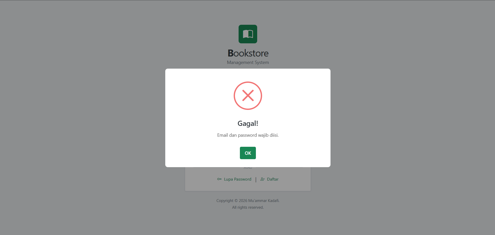

### 3. Login Berhasil

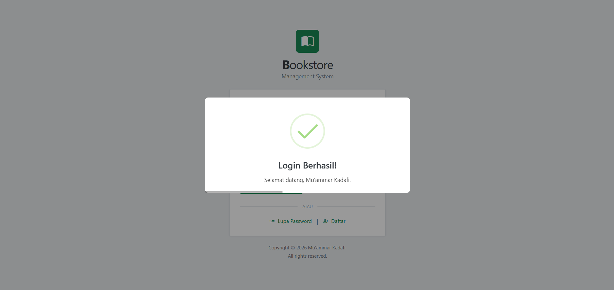

### 4. Dashboard

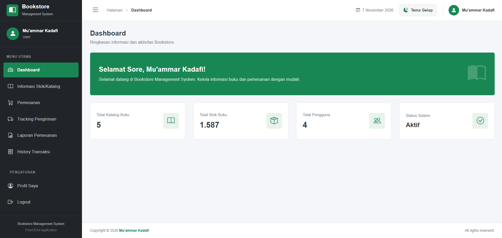

### 5. Katalog

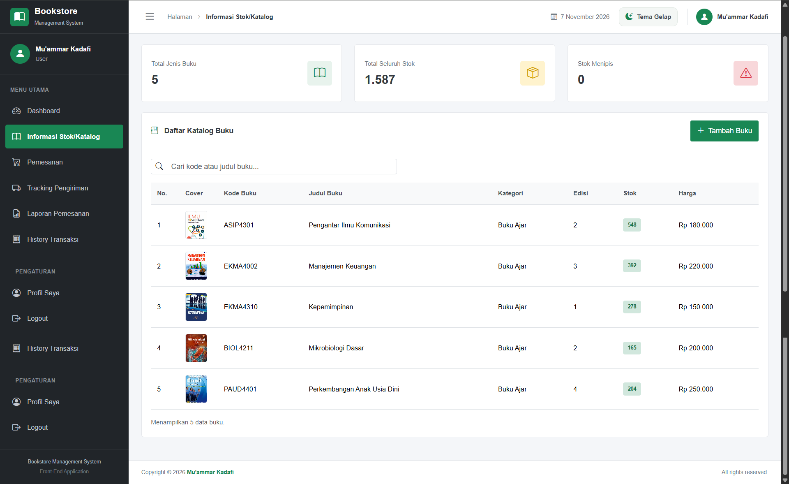

### 6. Pemesanan

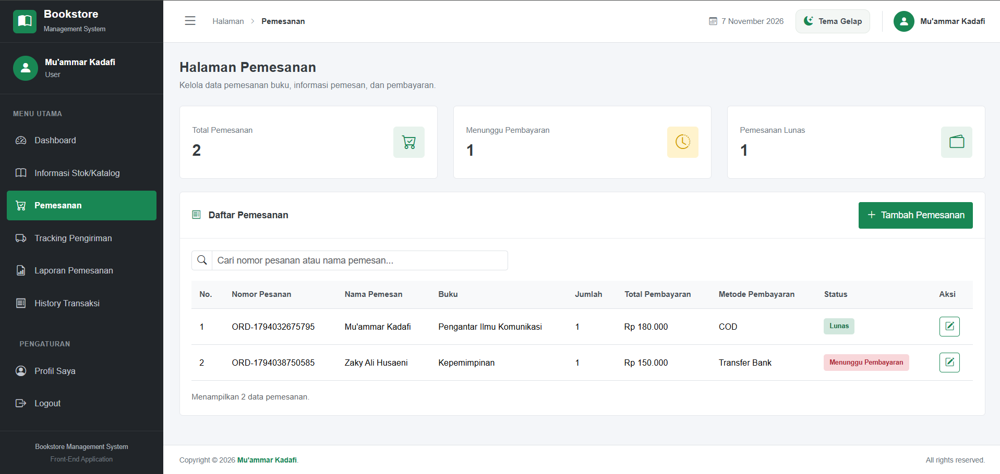

### 7. Tambah Pemesanan


### 8. Ubah Pemesanan

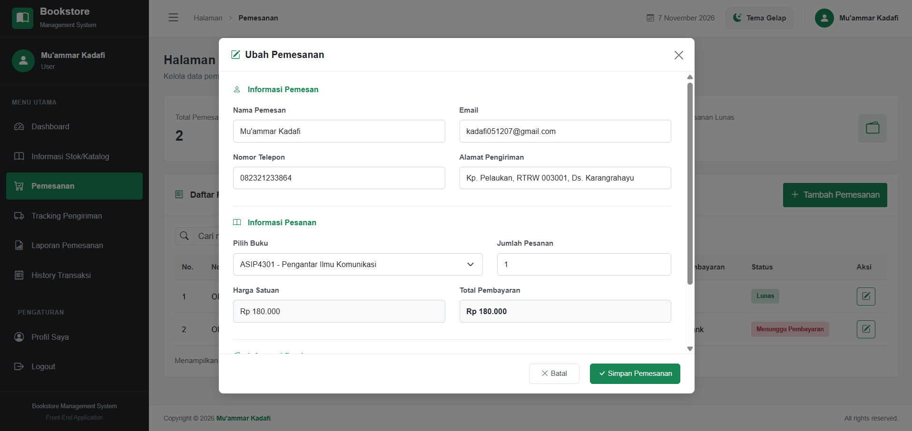

### 9. Tracking Pengiriman

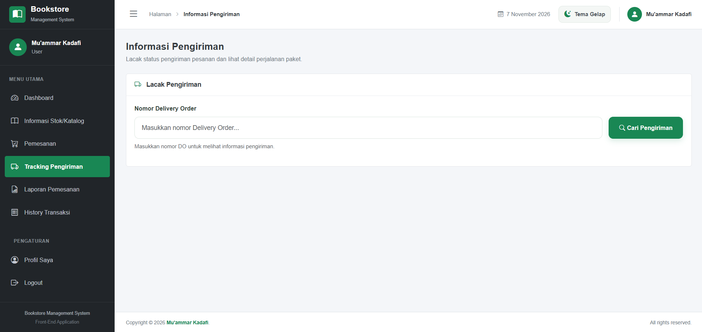

### 10. Pencarian Tracking

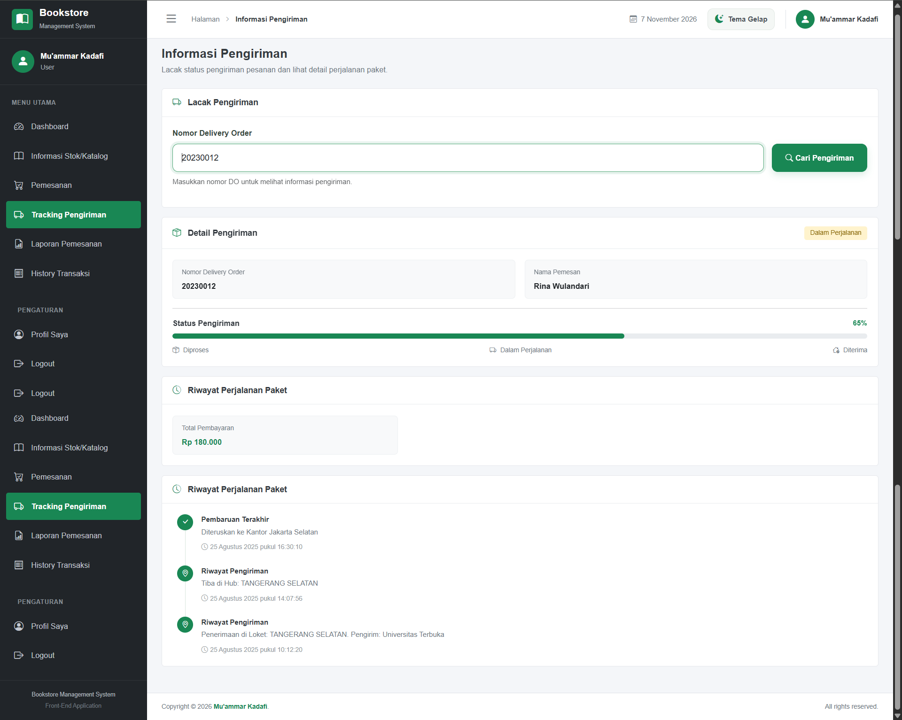

### 11. Laporan Pemesanan

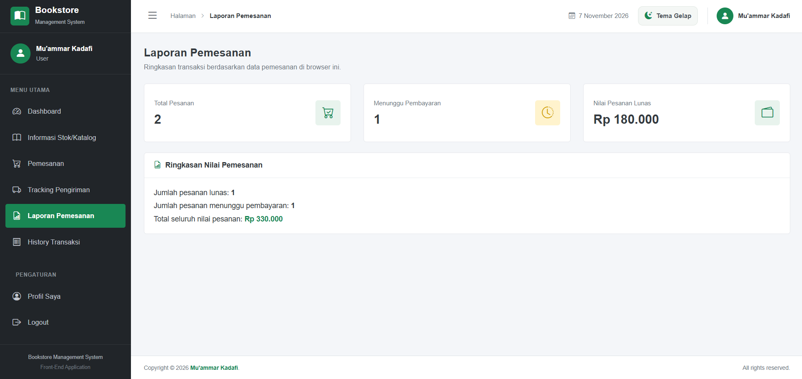

### 12. History Transaksi

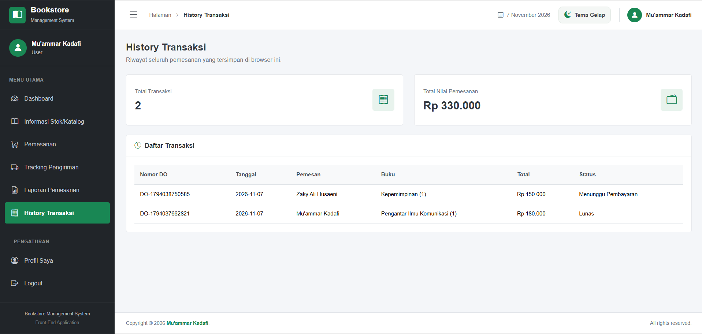

### 13. Profil Saya

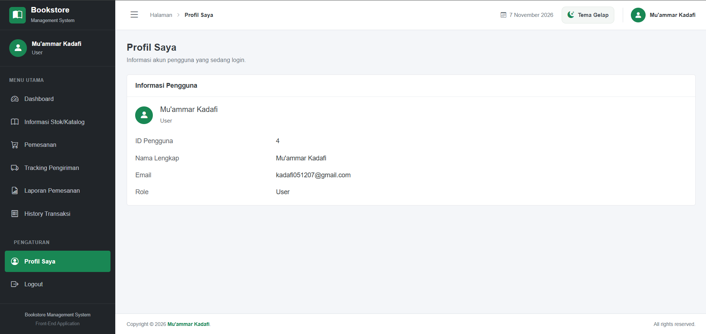

### 14. Logout

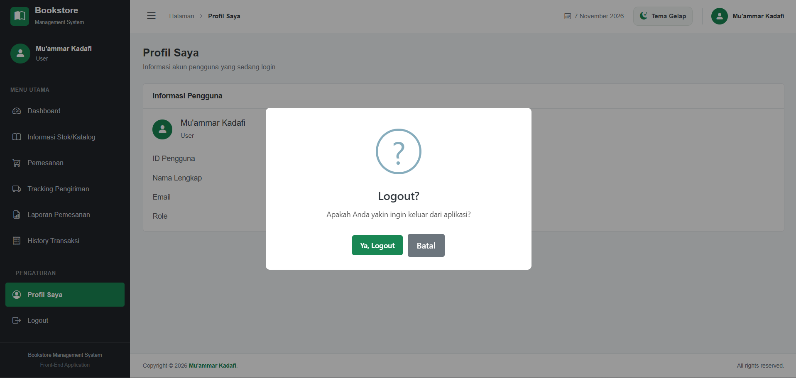

### 15. Dark/Light Mode

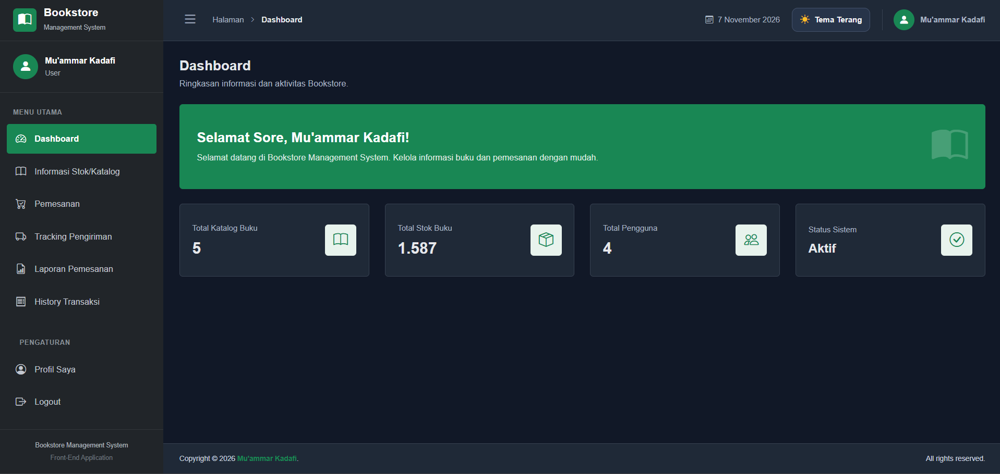

## Pengembang

**Mu’ammar Kadafi**  
Proyek Ujian Tengah Semester (UTS) – Mata Kuliah Pemrograman Web
